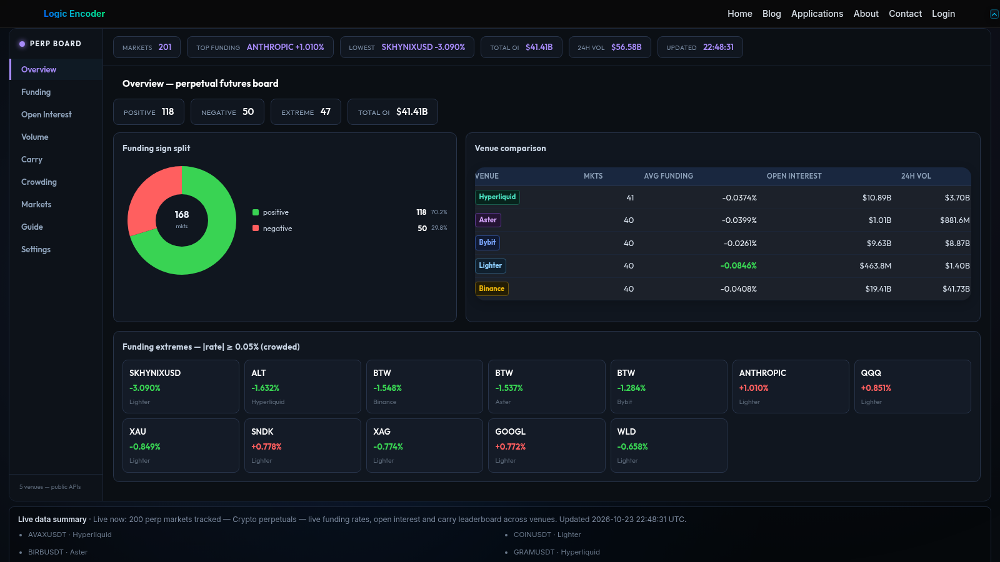

# Deriv Board — Perpetual Futures Markets

Funding, open interest and trading volume each describe a different part of a derivatives market. Deriv Board brings them into one comparison workspace for supported Binance and Bybit perpetual markets, helping users examine the context behind a headline rate.

## Tech stack

| Layer | Technologies |
|---|---|
| Core stack | Python; PHP; WordPress; JavaScript; SQLite |

## Compare supported markets

The markets board groups key information with venue filters, sortable columns and pagination. Mark prices, funding information and volume can be reviewed together. This gives the user a clearer starting point than opening each venue and product separately.

Venue filters let a reader compare the supported markets from a consistent starting point. Sort the board to bring a relevant rate, price or volume into view before opening a more focused comparison.

## Examine funding

The funding view keeps rates and the next funding time visible in context. Highlighting helps locate notable entries within the current selection. A funding figure is one observation about a market, not an independent forecast of its future price.

Read the funding rate together with its venue and next funding time. The dedicated view makes this relationship easier to examine across several markets in one session.

## Connect interest with activity

Open-interest and volume views help compare positioning-related information with trading activity. Switching between them can expose questions worth investigating in a particular market. Changes should be read with the available venue and time context.

These views support different questions about the same market. One emphasises the amount of open positioning, while the other shows trading activity that can provide additional context.

## Explore carry and crowding views

Dedicated carry and crowding areas provide additional ways to organise the published market information. They help users compare supported markets from more than one perspective. Their indicators support research rather than guaranteeing a trading result.

Switching perspectives helps avoid making every comparison about the largest single number. Carry and crowding views keep alternative ways of examining the published data within reach.

## Make repeated research easier

Overview, guide and display settings keep the investigation within a familiar workspace. The practical benefit is less repeated navigation while comparing related derivatives information. The board presents market data; execution and portfolio decisions remain separate tasks.

A typical session begins with the broad market board and follows a candidate through funding, interest and activity. The selected context stays within one research workspace.

---

Private code: [deriv-board-bridge](https://github.com/logicencoder/deriv-board-bridge)

See [REPOS.md](REPOS.md) for related repositories.

**[Logic Encoder](https://logicencoder.com)** · [GitHub](https://github.com/logicencoder) · [Contact](https://logicencoder.com/contact/)
